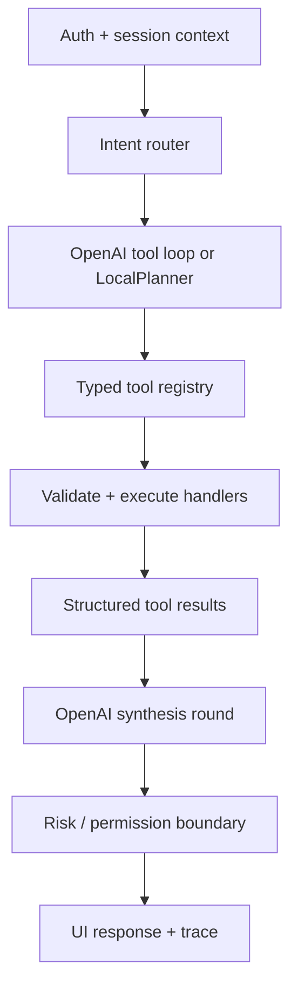

# CryptoNova Orchestrator V2 Architecture

## Purpose

Orchestrator V2 upgrades the chat control plane from **plan-then-execute** to a **bounded OpenAI Responses tool loop**, with mode-scoped tool visibility, local conversation memory, atomic spend reservation, and verified result contracts. Live exchange order submission remains gated and is **not** armed by this milestone (`AGENT_ALLOW_LIVE=false` by default).

## Request flow

## Module map

| Module | Responsibility |
|---|---|
| `agent/orchestrator/service.py` | Execution boundary (`Orchestrator.handle`), LocalPlanner, reply assembly |
| `agent/orchestrator/intent_router.py` | Hybrid: deterministic routes vs OpenAI synthesis |
| `agent/orchestrator/tool_registry.py` | `READ_ONLY` / `PAPER_CONTROL` / `LIVE_MUTATION` classification; `schemas_for` |
| `agent/orchestrator/tool_loop.py` | Bounded Responses loop with `call_id` → `function_call_output` |
| `agent/orchestrator/budget.py` + `usage_ledger.py` | Atomic `reserve` / `commit` / `release` with SQLite `BEGIN IMMEDIATE` |
| `agent/orchestrator/conversation_store.py` | Local SQLite threads under `data/orchestrator_conversations/` |
| `agent/orchestrator/result_contracts.py` | SUCCESS/PARTIAL/STALE/UNAVAILABLE/BLOCKED/ERROR envelopes |
| `agent/orchestrator/guard.py` | Injection refusal + hard `validate_tool_call` allowlist |
| `apps/api/app/orchestrator/router.py` | Chat API + conversations + diagnostics |
| `apps/web/src/app/orchestrator/` | History, traces, model/spend, decision inspector |

## Tool visibility

- **PAPER** (and LIVE chat when env not armed): OpenAI schemas = `READ_ONLY` + `PAPER_CONTROL` (+ `live_readiness` when LIVE chat).
- **LIVE + env armed**: mutation tools may appear in schemas; **Approve remains human + server-gated**.
- Empty `proposal_id` is **never** authority to approve the latest live order.
- `validate_tool_call` remains the hard execute gate even if the model emits a disallowed name.

## Conversation memory

- Store: SQLite only (no new Supabase tables).
- Chat accepts optional `conversation_id` and always returns one.
- Model input is bounded (`MAX_HISTORY_MESSAGES`); long threads get a deterministic local summary (no paid summarizer).

## Budget

- Caps (env): `$1/day`, `$5` monthly/total envelope (defaults).
- Per request: reserve → call → commit actual tokens/cost, or release on failure.
- Concurrent reserves use `BEGIN IMMEDIATE` so two oversized holds cannot both succeed.

## Paper autonomy

- Paper supervisor is **session-authorized** (`per_trade_approval=False`).
- Chat surfaces: start / pause / resume / halt + “explain last decision” / HOLD blockers via `supervisor_status`.
- Orchestrator never places paper fills from LLM opinion; supervisor + Risk Engine own execution.

## Live path (unchanged policy)

- Per-order Approve UI for MAINNET when armed.
- This milestone does **not** enable Bybit mainnet/testnet order submission in tests or defaults.

## Out of scope

- Changing leverage or risk limits
- New Supabase tables / RLS
- Unbounded paid OpenAI evaluation
- Claiming trading profitability from tests
